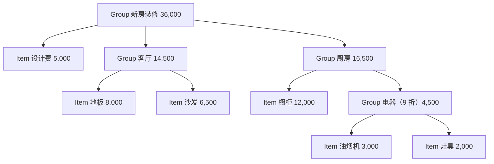

# 第 12 章　组合 Composite

> 本章要回答：当数据是一层套一层的树，而且每一层的深度都不固定时，怎样用同一种方式处理“一个东西”和“一组东西”？

很多数据天然是树形的：文件夹里有文件和子文件夹，公司里有部门和员工，菜单里有菜品和子菜单。处理这类数据时，最常见的麻烦是：代码默认了树有几层，而现实中的树不听话。

## 眼前的任务

一对年轻夫妇在装修新房，用一个小脚本记预算。一开始的结构很规整，每个房间下面列几个项目：

```python
budget = {
    "客厅": {"地板": 8000, "沙发": 6500},
    "厨房": {"橱柜": 12000, "油烟机": 3000, "灶具": 2000},
}
```

算总价，两层求和：

```python
def total(budget: dict) -> int:
    return sum(sum(room.values()) for room in budget.values())
```

结果是 31500。

## 不用模式的写法

上面就是。两层字典、两层求和，清楚直接。**结构固定的时候，这就是最好的写法。**

## 变化：结构不再规整

预算越记越细，结构开始走样：

- 设计费不属于任何房间，直接挂在最外层；
- 厨房电器是打包买的，于是“油烟机”和“灶具”被归进了厨房里的一个“电器”小组。

```python
budget_later = {
    "设计费": 5000,
    "客厅": {"地板": 8000, "沙发": 6500},
    "厨房": {"橱柜": 12000, "电器": {"油烟机": 3000, "灶具": 2000}},
}
```

`total(budget_later)` 直接崩溃了：最外层的 `5000` 是个数字，没有 `.values()`，抛出 `AttributeError`。即使去掉设计费，厨房里的“电器”是个字典，`sum` 试图把数字和字典相加，又会抛出 `TypeError`（测试 `test_mixed_depth_breaks`）。

再看其他需求：打印一份带小计的预算清单；找出所有花费超过 6000 元的单个项目；电器打包有九折优惠。每一个功能都要遍历这棵树，而每一个都会遇到同样的问题：**某个位置上的东西，可能是一个项目，也可能是一组项目，组里又可能有组。**

如果用 `isinstance` 在每个功能里分别判断“这是数字还是字典”，每多一层嵌套就要多一层判断，四个功能就要写四遍。

## 困难在哪里

困难的核心是：调用方必须**区分**单个项目和项目组，而它其实并不关心这个区别。算总价时，它想问的只是“你花多少钱？”。单个项目回答自己的价格，一组项目回答组里所有东西的价格之和。

如果单个项目和项目组能**用同一种方式回答同一个问题**，调用方就不需要区分它们，也就不需要关心树有多深。

## 组合：一个和一组，用同一个接口

GoF 对组合模式的描述是：**将对象组合成树形结构以表示“部分—整体”的层次结构，使得用户对单个对象和组合对象的使用具有一致性。**

先定义“预算里的任何一个节点”都要能回答的问题：花多少钱，以及怎样把自己列进清单：

```python
class BudgetNode(Protocol):
    name: str

    def cost(self) -> int: ...
    def lines(self, depth: int = 0) -> list[str]: ...
```

单个项目是树的**叶子**。它的花费是单价乘以数量：

```python
class Item:
    """叶子：一个具体的项目。"""

    def __init__(self, name: str, unit_price: int, qty: int = 1) -> None:
        self.name, self.unit_price, self.qty = name, unit_price, qty

    def cost(self) -> int:
        return self.unit_price * self.qty
```

项目组是树的**组合节点**。它的花费是所有子节点花费之和，再乘以折扣。它不需要知道子节点是项目还是组，只管问 `child.cost()`：

```python
    def cost(self) -> int:
        return round(sum(child.cost() for child in self.children) * self.percent / 100)
```

列清单也一样：组合节点先写自己这一行，再请每个子节点把自己列出来，缩进加一层：

```python
    def lines(self, depth: int = 0) -> list[str]:
        note = f"（打包 {self.percent / 10:g} 折）" if self.percent != 100 else ""
        head = f"{'  ' * depth}{self.name} {self.cost():,}{note}"
        return [head] + [line for child in self.children for line in child.lines(depth + 1)]
```

搭出整棵预算树：

```python
def new_home() -> Group:
    return Group("新房装修").add(
        Item("设计费", 5000),
        Group("客厅").add(Item("地板", 200, qty=40), Item("沙发", 6500)),
        Group("厨房").add(
            Item("橱柜", 12000),
            Group("电器", percent=90).add(Item("油烟机", 3000), Item("灶具", 2000)),
        ),
    )
```

```text
新房装修 36,000
  设计费 5,000
  客厅 14,500
    地板 8,000
    沙发 6,500
  厨房 16,500
    橱柜 12,000
    电器 4,500（打包 9 折）
      油烟机 3,000
      灶具 2,000
```

设计费是一个项目，客厅是一个组，它们并排放在最外层，`new_home().children` 里每个元素都能回答 `cost()`，分别是 5000、14500 和 16500（测试 `test_leaf_and_group_are_used_the_same_way`）。电器组的九折只写在 `Group.cost` 里一处，它会自动影响厨房的小计和总价。地板按每平方米 200 元、40 平方米记，这个计算细节也只属于 `Item`，组不需要知道。

再加一层嵌套、再加一个房间，都不需要修改任何遍历代码。

整棵预算树的结构如下。每个节点都能回答 `cost()`，调用方不必知道它是项目还是组：



### 防止环

树有一个隐含的要求：不能有环。如果不小心把“厨房”放进了它自己的子组“电器”里，`cost()` 会无限递归下去，最终抛出 `RecursionError`。`Group.add` 在加入子节点前检查这一点，发现会形成环就立即报错（测试 `test_no_cycles`）：

```python
    def add(self, *nodes: BudgetNode) -> Group:
        for node in nodes:
            if node is self or (isinstance(node, Group) and node.contains(self)):
                raise ValueError(f"不能把“{node.name}”放进它自己里面")
            self.children.append(node)
        return self
```

这个检查要遍历被加入的子树，代价随子树大小增长。对一份家庭装修预算来说无所谓；如果树很大、`add` 调用很频繁，就要考虑别的办法，比如记录每个节点的父节点。

### 透明与安全

GoF 讨论过一个设计选择：`add` 这类管理子节点的方法，要不要放在共同的接口上？

- 放在接口上（**透明**）：调用方连“是不是组”都不用判断，但对一个项目调用 `add` 就没有意义，只能在运行时报错。
- 只放在组合节点上（**安全**）：项目上根本没有 `add`，类型检查能发现误用，但需要往树里加东西的代码，就得知道自己面对的是组。

本章选了“安全”：`BudgetNode` 只有 `cost` 和 `lines`，`add` 只在 `Group` 上。在 Python 里这通常是更好的选择，因为需要添加子节点的地方（比如搭建预算树的 `new_home`），本来就清楚自己在操作哪个组。

### 角色对照

| GoF 角色 | 本例 | 职责 |
|---|---|---|
| 组件（Component） | `BudgetNode` 协议 | 叶子和组合共同的接口 |
| 叶子（Leaf） | `Item` | 没有子节点，直接给出结果 |
| 组合（Composite） | `Group` | 保存子节点，把请求转发给它们并汇总 |
| 客户（Client） | 打印清单、算总价的代码 | 只通过组件接口操作整棵树 |

## 代价与边界

- **“统一”有时是假的。** 不是所有操作都对叶子和组合都有意义。比如“找出所有花费超过 6000 元的单个项目”，这个问题只对单个项目有意义，对组来说只是“往下找”。本章的 `expensive` 函数仍然用了一次 `isinstance` 来区分。强行在 `BudgetNode` 上加一个 `expensive` 方法，让 `Group` 返回子节点的结果、`Item` 返回自己，也可以，但接口会随着每个新需求膨胀。
- **调试要跟着递归走。** 总价不对时，要一层一层往下看是哪个节点算错了。带小计的清单在这里很有帮助。
- **整棵树都在内存里。** 对家庭预算没有问题；对一个包含几百万文件的目录树，一次性构造所有对象可能就不现实了，需要边遍历边处理。
- **约束靠自己维护。** 不能有环、一个节点不能同时属于两个组，这些规则组合模式本身不提供，要像本章的 `add` 一样自己检查。

**什么时候不该用**：结构的深度是固定的，而且不会变。如果预算永远只有“房间 → 项目”两层，开头那个两层求和的函数比任何树结构都清楚。

## Python 角度：数据本来就是树

回头看 `budget_later`：嵌套的字典本身就已经是一棵树了。叶子是数字，组合是字典。如果只是要算总价、列清单，不需要定义任何类，一个递归函数就能处理任意深度：

```python
def total(node: Budget) -> int:
    if isinstance(node, int):
        return node
    return sum(total(child) for child in node.values())
```

这里的 `isinstance` 只出现在一个地方，它就是“叶子还是组合”的唯一判断，作用和组合模式中的两个类是一样的。对 `budget_later`，它算出 36500。数据来自 JSON 文件、结构简单、只需要几种统计时，这就是最省事的写法。

但注意这个数字和组合版本的 36000 不同：差的 500 元，正是电器的九折。**嵌套字典里没有地方表达“这一组打九折”**。要表达它，就得约定一个特殊的键，比如 `"_折扣": 90`，然后每个递归函数都要记得跳过它。节点的种类越多、每种节点的行为越不同（按面积计价、打包折扣、可选项目……），用类来表达就越划算，因为每种行为可以写在自己的类里，而不是散布在每个递归函数的 `if` 分支中。

一个实用的组合是：用嵌套字典或 JSON **保存**预算，读进来时**转换**成 `Item` 和 `Group` 对象，再进行计算。数据格式保持简单，行为放在类里。

## 小结

- 当数据是深度不固定的树，而调用方并不关心某个节点是单个东西还是一组东西时，组合模式让两者实现同一个接口，调用方就不必再区分。
- 组合节点把请求转发给子节点并汇总结果；每种节点的特殊规则（数量、折扣）只写在自己的类里。
- 组合模式本身不阻止环和重复归属，这些约束要自己检查。管理子节点的方法通常只放在组合节点上更安全。
- 在 Python 里，嵌套的字典和列表本身就是树，简单的统计用一个递归函数就够了；节点的行为开始分化时，再引入类。

## 练习

夫妇俩想给预算加一个“可选项目”的标记，比如“投影仪”，可以先列进预算，但暂时不计入总价。他们还想看“如果全部可选项目都买，总价是多少”。

1. 在组合模式的写法里，你会怎样表示“可选”？需要修改 `Item`、`Group`，还是新增一个类？
2. “全部都买时的总价”和“不含可选项目的总价”，应该是两个方法，还是一个方法带一个参数？
3. 在嵌套字典的写法里，怎样表示“可选”？会给 `total` 函数带来什么变化？

**思路提示**：一种做法是给 `Item` 加一个 `optional` 字段，并给 `cost` 加一个参数 `include_optional: bool = False`。`Group.cost` 把这个参数原样传给子节点，这正是组合模式的好处：新规则只在叶子上实现，组只负责转发。这比写两个方法更好，因为两个方法意味着 `Group` 也要实现两遍汇总逻辑。另一种做法是新增一个 `OptionalItem` 类，它在不包含可选项时返回 0。嵌套字典里没有地方放“可选”这个标记，只能改变叶子的形状（比如从数字改成 `{"price": 3000, "optional": true}`），于是 `total` 里判断“叶子”的条件也要跟着变。这再次说明：节点的属性一多，类比裸数据更容易扩展。

完整代码：
- [`examples/ch12_budget_v1.py`](../../examples/ch12_budget_v1.py)：固定两层的写法，以及让它崩溃的数据
- [`examples/ch12_composite.py`](../../examples/ch12_composite.py)：`Item`、`Group` 与防止环
- [`examples/ch12_pythonic.py`](../../examples/ch12_pythonic.py)：嵌套字典上的递归函数

测试：[`tests/test_ch12_composite.py`](../../tests/test_ch12_composite.py)。
