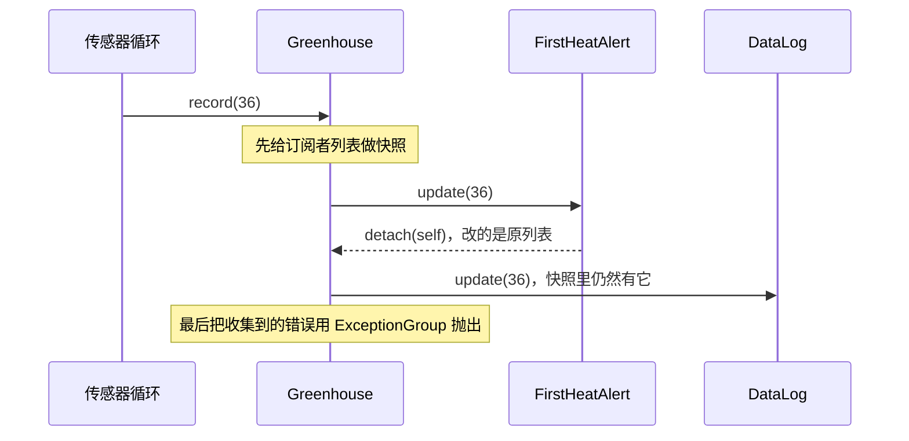

# 第 18 章　观察者 Observer

> 本章要回答：一个对象的状态变了，好几个别的对象需要做出反应，怎样让它不必知道这些对象是谁？通知的顺序、出错和退订，又该怎样约定？

观察者的基本思想一句话就能说完：“有变化时，通知所有订阅了的人。”它的写法也只有十几行。但正因为简单，它最容易留下没想清楚的问题：通知按什么顺序？某个订阅者出错了，其他人还通知不通知？通知进行到一半时有人退订，会发生什么？这一章会把这些问题一个个摆出来，并且给出**明确的约定**。

## 眼前的任务

一个育苗温室装了温度传感器，每隔几分钟读一次温度。每次读数，要做三件事：

- 温度达到 30℃ 时打开风扇，低于 30℃ 时关掉；
- 温度达到 35℃ 时发出警报；
- 把每一次读数记录下来，供以后分析。

## 不用模式的写法

温室对象记录温度，然后逐个调用这三个部件：

```python
class Greenhouse:
    def __init__(self, fan: Fan, alarm: Alarm, log: DataLog) -> None:
        self.fan, self.alarm, self.log = fan, alarm, log
        self.temp: float | None = None

    def record(self, temp: float) -> None:
        self.temp = temp
        self.fan.update(temp)
        self.alarm.check(temp)
        self.log.write(temp)
```

依次读到 28、31、36℃ 之后，风扇开着，警报响了一次，记录里有三条读数。**这是好代码**：三个部件，固定不变，一眼就能看出温度变化后会发生什么。

## 变化：关心温度的人越来越多

温室运营了一段时间，需求一个接一个：

- 夏天加装了湿帘，温度高时也要打开；
- 要把读数上传到云端，方便在手机上查看；
- 种植员要求“每天第一次超过 35℃ 时通知一次就好，别一直响”；
- 有些部件只在某个季节需要，冬天要把湿帘拆掉。

每多一个关心温度的部件，`Greenhouse` 就要多一个构造参数、`record` 就要多一行调用。而且这个类的测试，必须把所有部件都准备好才能创建温室。

问题的根源是：**温室知道太多了。** 它的职责只是“记录温度”，却必须知道有哪些部件、每个部件的方法叫什么名字。那些部件才是真正“关心温度”的一方。

## 观察者：让关心的人自己来订阅

GoF 对观察者的描述是：**定义对象间的一种一对多的依赖关系，当一个对象的状态发生改变时，所有依赖于它的对象都得到通知并被自动更新。**

做法是反过来：温室不再持有固定的几个部件，而是维护一个**订阅者列表**。任何对象，只要有一个 `update(temp)` 方法，就可以订阅：

```python
class Observer(Protocol):
    def update(self, temp: float) -> None: ...
```

温室只需要提供订阅、退订和通知。最直接的写法是这样：

```python
class NaiveGreenhouse:
    def __init__(self) -> None:
        self._observers: list[Observer] = []

    def attach(self, observer: Observer) -> None:
        self._observers.append(observer)

    def detach(self, observer: Observer) -> None:
        self._observers.remove(observer)

    def record(self, temp: float) -> None:
        for observer in self._observers:
            observer.update(temp)
```

风扇、记录器各自实现 `update`，订阅到温室上。加湿帘、加云端上传，都不用再改温室。

这个写法有两个问题，它们不会在第一天就出现。

### 问题一：通知到一半时有人退订

“每天第一次超过 35℃ 时通知一次”的需求，最自然的写法是：提醒一次之后，**自己退订**。

```python
class FirstHeatAlert:
    """第一次超过 35℃ 时提醒一次，然后自己退订。"""

    def __init__(self, house: Greenhouse | NaiveGreenhouse) -> None:
        self.house = house
        self.messages: list[str] = []

    def update(self, temp: float) -> None:
        if temp >= 35:
            self.messages.append(f"今天第一次超过 35℃：{temp}℃")
            self.house.detach(self)
```

订阅顺序是“首次高温提醒”在前，“记录器”在后。依次读到 28、36、37℃。记录器里应该有三条，实际上只有 `[28, 37]`，**36℃ 那一条丢了**（测试 `test_detaching_during_notify_skips_the_next_observer`）。

原因是 `for observer in self._observers` 正在遍历这个列表，而提醒对象在遍历过程中把自己从列表里删除了。删除之后，后面的元素往前挪了一位，循环的下一步就跳过了原本紧跟在后面的记录器。这是 Python 列表在“边遍历边修改”时的行为，不会报错，只会悄悄漏掉。

### 问题二：一个订阅者出错

云端上传在网络断开时会抛出 `ConnectionError`。如果上传模块排在记录器前面，网络一断，`record` 在上传那一步就因为异常中断了，后面的记录器根本没有被通知到（测试 `test_one_error_stops_everyone_after_it`）。一个和温度控制毫无关系的网络问题，让本地的数据记录也停了。

## 把约定写清楚

这两个问题没有唯一正确的答案，但必须**有一个答案**，并且写下来。本章的温室采用如下约定，写在类的文档字符串里：

```python
class Greenhouse:
    """通知约定：
    1. 按订阅的先后顺序通知；
    2. 通知开始时对订阅者列表做一个快照，通知过程中的订阅和退订，从下一次才生效；
    3. 一个订阅者出错，不影响其他订阅者；全部通知完之后，把所有错误一起抛出。
    """
```

实现这三条约定只需要几行：

```python
    def record(self, temp: float) -> None:
        self.temp = temp
        errors: list[Exception] = []
        for observer in tuple(self._observers):
            try:
                observer.update(temp)
            except Exception as e:
                errors.append(e)
        if errors:
            raise ExceptionGroup(f"{len(errors)} 个订阅者出错", errors)
```

- `tuple(self._observers)` 在开始通知前复制了一份列表。提醒对象在通知中退订，改的是原列表，不影响这一轮正在遍历的快照。记录器拿到了全部三条读数（测试 `test_detaching_during_notify_is_safe`）。
- 每个订阅者的调用都包在 `try` 里。上传失败了，风扇照样打开，记录照样写入。
- 错误没有被吞掉。全部通知完之后，所有错误被打包成一个 `ExceptionGroup` 抛出（Python 3.11 新增），调用 `record` 的代码可以知道哪些订阅者出了问题（测试 `test_errors_are_collected_and_others_still_notified`）。

这只是一种合理的约定，不是唯一的。另一些系统选择“记录日志后继续，不向上抛出”，或者“任何一个出错就立即停止”。选哪一种，取决于订阅者之间是否独立、错误是否需要被调用方处理。**重要的是选了之后写下来，并且用测试固定住。**

还有一点要说明：在“按订阅顺序通知”这条约定下，订阅者不应该**依赖**这个顺序。如果“风扇必须在湿帘之前打开”，这个先后关系就不该靠订阅的先后来保证，而应该由一个专门的对象（比如一个“降温控制器”）统一安排。订阅顺序只是为了让行为可预测、可测试。

下图是读到 36℃ 时的一次通知，对照约定看快照的作用：



### 角色对照

| GoF 角色 | 本例 | 职责 |
|---|---|---|
| 目标（Subject） | `Greenhouse` | 保存订阅者，状态变化时通知它们 |
| 观察者（Observer） | `Observer` 协议 | 定义收到通知时调用的接口 |
| 具体观察者（ConcreteObserver） | `Fan`、`DataLog`、`FirstHeatAlert`、`CloudUploader` | 收到通知后做自己的事 |

GoF 讨论过两种传递信息的方式：**推**（通知时把新数据直接传给观察者，本例的 `update(temp)`）和**拉**（只通知“变了”，观察者再去目标那里读需要的数据）。推的方式简单直接；拉的方式在不同观察者需要不同数据时更灵活，代价是观察者要持有目标的引用。

## 代价与边界

- **流程变得不可见。** 读 `Greenhouse.record` 的代码，再也看不出温度变化之后会发生什么，要去找所有 `attach` 的地方。调试时“为什么风扇开了”需要更多的追踪。
- **通知是同步的。** `record` 要等所有订阅者的 `update` 都执行完才返回。一个慢的订阅者（比如网络上传）会拖慢每一次读数。如果需要异步，那是另一层设计：队列、线程或 `asyncio`，它们带来新的约定（顺序是否保证、失败是否重试）。
- **生命周期要管理。** 温室持有每个订阅者的引用。一个订阅者如果忘记退订，就会一直留在列表里，一直收到通知，也一直不会被垃圾回收。标准库的 `weakref` 模块可以让目标只持有“弱引用”，订阅者被回收后自动消失，但它也有自己的细节需要处理，本章不展开。
- **级联更新。** 如果某个订阅者在 `update` 里又修改了温室的状态，就会触发新一轮通知，可能形成循环。本章的约定没有处理这种情况，最简单的规则是：订阅者不应在收到通知时修改目标。

**什么时候不该用**：反应者固定、数量少，而且确实需要按特定顺序执行。开头那个直接调用三个部件的版本，流程一目了然，顺序由代码决定，没有任何隐含约定。只有当“谁关心这个变化”经常变化，或者由别的模块决定时，观察者才值得它带来的间接性。

## Python 角度：订阅者就是一个函数

在 Python 里，订阅者不必是有 `update` 方法的对象，任何可调用对象都行：普通函数、`lambda`、绑定方法（比如 `readings.append`）。于是可以写一个通用的小类，专门负责“订阅和通知”，并且让订阅返回一个**取消订阅的函数**：

```python
class Signal:
    def __init__(self) -> None:
        self._handlers: list[Handler] = []

    def connect(self, handler: Handler) -> Callable[[], None]:
        self._handlers.append(handler)

        def disconnect() -> None:
            if handler in self._handlers:
                self._handlers.remove(handler)

        return disconnect
```

`emit` 采用和 `Greenhouse.record` 相同的约定：快照、逐个调用、收集错误。温室只需要拥有一个 `Signal`：

```python
    house = Greenhouse()
    readings: list[float] = []
    stop = house.temp_changed.connect(readings.append)
    house.record(28)
    stop()
    house.record(31)
```

`readings` 是 `[28]`，取消订阅之后的读数不再收到。返回取消函数的好处是：调用方不需要保留“自己订阅了什么”的引用，拿着 `stop` 就能退订；重复调用也不会出错（测试 `test_connect_returns_disconnect`）。

标准库里也有观察者的影子。`logging` 模块中，一个 `Logger` 可以挂上多个 `Handler`，每条日志会依次交给这些处理器：写文件、打印到屏幕、发邮件。日志产生的地方不需要知道日志最终去了哪里，这正是观察者的思想。

## 小结

- 当一个对象的变化需要引起若干其他对象的反应，而“谁需要反应”经常变化时，观察者让目标只维护一个订阅者列表，状态变化时通知它们。
- 观察者最容易出问题的地方不在结构，而在没说清楚的约定：通知顺序、通知中订阅和退订的效果、订阅者出错时怎么办、订阅者的生命周期。这些都要明确写下来，并用测试固定。
- 本章的约定是：按订阅顺序；遍历快照；逐个隔离错误，最后用 `ExceptionGroup` 一起报告。这是一种合理的选择，不是唯一的选择。
- 在 Python 里，订阅者可以就是一个函数；让订阅返回一个取消函数，可以简化生命周期管理。

## 练习

温室接入了一个“自动浇水”订阅者：温度超过 32℃ 时打开水阀。有一天，水阀的驱动程序出了故障，每次调用都抛出异常。

1. 按本章的约定，水阀出错时，风扇和记录器会怎样？`record` 的调用方会看到什么？
2. 调用 `record` 的是传感器的读取循环。它收到 `ExceptionGroup` 之后应该怎么做？继续读下一次，还是停止？
3. 如果希望“水阀连续出错 3 次就自动退订，并通知管理员”，这段逻辑应该写在哪里：温室、水阀，还是一个新的对象？

**思路提示**：按约定，风扇和记录器照常工作，`record` 在通知完所有人之后抛出一个只包含水阀错误的 `ExceptionGroup`。读取循环应该把错误记录下来（或者交给管理员），然后继续读下一次，因为温度监测本身不应该因为一个执行部件的故障而停止。这正是“错误隔离”这条约定的意义。第 3 问：把“连续出错就退订”写进温室，会让温室开始关心某个具体订阅者的健康状况，违背了它“只管通知”的职责。更好的办法是用一个包装对象包住水阀（[第 13 章](../part-03/13-decorator.md)的装饰器思路）：它计数，连续失败 3 次就从温室退订自己并发出通知。这样温室的约定保持简单，特殊的策略放在需要它的地方。

完整代码：
- [`examples/ch18_greenhouse_v1.py`](../../examples/ch18_greenhouse_v1.py)：温室直接调用各个部件
- [`examples/ch18_observer.py`](../../examples/ch18_observer.py)：朴素写法的两个陷阱，以及带约定的 `Greenhouse`
- [`examples/ch18_pythonic.py`](../../examples/ch18_pythonic.py)：函数订阅者与 `Signal`

测试：[`tests/test_ch18_observer.py`](../../tests/test_ch18_observer.py)。
