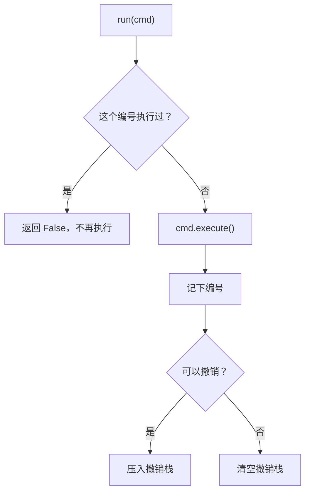

# 第 19 章　命令 Command

> 本章要回答：怎样把“一次操作”变成一个可以保存、排队、撤销、重试的东西？撤销、幂等和重试有什么区别？哪些操作根本撤销不了？

很多人第一次听说命令模式，是在“撤销”的语境里。撤销确实是它最有名的用途，但命令模式的本质更朴素：**把一个请求变成一个对象**。一旦请求成了对象，它就可以被记录、排队、撤销、重发。这一章会把这几种用途分开讲，因为它们是**不同的问题**，常被混为一谈。

## 眼前的任务

一个五金配件的小仓库，用一个程序管理库存。库存就是一个字典：配件编号 → 数量。入库、出库是两个函数：

```python
def stock_in(inventory: dict[str, int], sku: str, qty: int) -> None:
    inventory[sku] = inventory.get(sku, 0) + qty


def stock_out(inventory: dict[str, int], sku: str, qty: int) -> None:
    if inventory.get(sku, 0) < qty:
        raise ValueError(f"{sku} 库存不足")
    inventory[sku] -= qty
```

## 不用模式的写法

上面就是。操作员在界面上点“出库”，程序调用 `stock_out`，库存减少。**这是好代码**，简单直接。

## 变化：三个新需求

仓库用了一阵，提出了三个需求，听起来都和“操作”有关。

**一、撤销。** 操作员把 30 件输成了 300 件，或者点错了配件，想撤销上一步。可 `stock_out` 执行完就结束了，程序不记得刚才做了什么，也就无从撤销。

**二、重发不能重复生效。** 仓库用无线扫码枪出库。网络不好时，扫码枪发出“出库 30 件”之后没收到回复，会自动重发一次。但第一次其实已经成功了，只是回复丢了。结果同一次出库被执行了两遍，100 件变成了 40 件（`ch19_stock_v1.py` 的演示）。

**三、有些操作要通知外部。** 库存低于警戒线时，要给供应商发补货通知。

## 困难在哪里

这三个需求的共同点是：程序需要**把一次操作当作一个东西来对待**。要撤销，得记住“刚才那次操作是什么”；要防止重复执行，得能识别“这次和上次是不是同一个操作”。而现在的操作只是一次函数调用，调用完就没了。

但是，这三个需求要的东西并不一样，值得先分清楚：

- **撤销**（undo）：让一个已经发生的操作的效果**消失**，回到操作前的状态。
- **幂等**（idempotence）：同一个操作执行一次和执行多次，**效果相同**。
- **重试**（retry）：操作失败或者不确定是否成功时，**再执行一次**。

重试是一种**行为**，幂等是让重试变得**安全**的性质，撤销是另一个独立的能力。一个操作可以幂等但不能撤销（发出的通知无法收回，但同一条通知可以保证只发一次），也可以能撤销但不幂等（入库 30 件可以撤销，但执行两次就是 60 件）。

## 命令：把操作变成对象

GoF 对命令模式的描述是：**将一个请求封装为一个对象，从而使你可用不同的请求对客户进行参数化；对请求排队或记录请求日志，以及支持可撤销的操作。**

每个命令对象包含执行一次操作所需的全部信息，有一个唯一编号，知道怎样执行自己，以及（如果可以的话）怎样撤销自己：

```python
class Command(Protocol):
    id: str
    undoable: bool

    def execute(self, inv: dict[str, int]) -> None: ...
    def undo(self, inv: dict[str, int]) -> None: ...
```

出库命令的撤销很简单，把数量加回去：

```python
@dataclass
class StockOut:
    id: str
    sku: str
    qty: int
    undoable: bool = True

    def execute(self, inv: dict[str, int]) -> None:
        if inv.get(self.sku, 0) < self.qty:
            raise ValueError(f"{self.sku} 库存不足")
        inv[self.sku] -= self.qty

    def undo(self, inv: dict[str, int]) -> None:
        inv[self.sku] += self.qty
```

### 撤销需要的信息，可能要在执行时才知道

盘点是另一种操作：操作员清点了实际数量，把库存直接改成这个数。它的撤销不是“加回去”或“减回去”，而是“改回原来的数”。而原来是多少，**只有在执行的那一刻才知道**。所以命令要在执行时把它记下来：

```python
@dataclass
class SetCount:
    """盘点：把库存改成实际清点出的数量。撤销需要知道改之前是多少。"""

    id: str
    sku: str
    counted: int
    undoable: bool = True
    _previous: int | None = field(default=None, repr=False)

    def execute(self, inv: dict[str, int]) -> None:
        self._previous = inv.get(self.sku, 0)
        inv[self.sku] = self.counted

    def undo(self, inv: dict[str, int]) -> None:
        assert self._previous is not None, "还没有执行过，不能撤销"
        inv[self.sku] = self._previous
```

这说明：**命令对象不只是“参数的打包”，它还可能保存执行过程中产生的、撤销时需要的状态。**

### 有些操作撤销不了

给供应商发补货通知，消息一旦发出就收不回来。把它也写成命令，但明确标记为不可撤销：

```python
@dataclass
class NotifySupplier:
    """给供应商发补货通知。消息发出去就收不回来了。"""

    id: str
    sku: str
    outbox: list[str]
    undoable: bool = False

    def execute(self, inv: dict[str, int]) -> None:
        self.outbox.append(f"请补货：{self.sku}，当前库存 {inv.get(self.sku, 0)}")

    def undo(self, inv: dict[str, int]) -> None:
        raise NotImplementedError("已发出的通知无法撤回")
```

最接近“撤销”的做法，是再发一条“上一条通知作废”的消息。但那是一个**新的操作**，而不是让原来的操作消失：供应商已经看到了第一条消息。真实系统里，大部分对外部世界的操作都是这样：发出的邮件、扣过的款、打印出的单据。设计撤销功能时，先要承认这些操作的存在。

### 调用者：执行、记录、撤销

命令对象由一个“调用者”来执行。它负责三件事：执行命令，记住执行过哪些编号，维护撤销栈：

```python
    def run(self, cmd: Command) -> bool:
        """执行一条命令。同一编号的命令只生效一次，重复提交返回 False。"""
        if cmd.id in self._done_ids:
            return False
        cmd.execute(self.inventory)
        self._done_ids.add(cmd.id)
        if cmd.undoable:
            self._undo_stack.append(cmd)
        else:
            self._undo_stack.clear()  # 不可撤销的操作之前的步骤，也不能再撤销了
        return True
```

这几行分别回应了三个需求：

- **幂等**：扫码枪的每一次出库请求带着一个编号（比如 `op-17`）。重发时编号不变，`run` 发现已经执行过，直接返回 `False`，不会扣第二次（测试 `test_same_id_applies_once`）。这里的幂等是**调用者**通过记录编号实现的，命令本身（出库）并不幂等。
- **撤销**：可撤销的命令压进栈，`undo` 弹出最近的一条并调用它的 `undo`。连续撤销按相反的顺序进行（测试 `test_undo_in_reverse_order`）。
- **不可撤销的操作**：执行不可撤销的命令时，清空撤销栈。原因是：通知发出时的库存是 10 件；如果允许撤销通知之前的出库，库存会变回 100 件，而供应商手里那条“当前库存 10 件，请补货”的通知就与事实不符了。所以，**不可撤销的操作是一道墙，墙之前的操作也不能再撤销**（测试 `test_irreversible_step_blocks_undo`）。

还有一个细节：执行失败的命令（比如库存不足）不会被记录编号，可以修正后用同一个编号再提交（测试 `test_failed_command_is_not_recorded`）。这个规则也要写清楚：如果命令执行到一半失败了，留下了部分效果，事情就复杂得多，那需要事务，超出了本章的范围。

`Ledger.run` 的判断过程如下：



### 重试在哪里

本章的 `Ledger` 没有一行“重试”的代码。重试发生在扫码枪那一侧：没收到回复，就用**同一个编号**再发一次。`Ledger` 做的只是保证这种重试是**安全的**。这就是“重试是一种行为，幂等是让它安全的性质”的意思。

注意 `_done_ids` 只保存在内存里。如果程序重启，记录就没了，重启前发出、重启后才重发的请求又会被执行一次。真实系统需要把已执行的编号持久化（比如写进数据库，和库存的修改放在同一个事务里）。

### 角色对照

| GoF 角色 | 本例 | 职责 |
|---|---|---|
| 命令（Command） | `Command` 协议 | 声明执行（和撤销）的接口 |
| 具体命令（ConcreteCommand） | `StockIn`、`StockOut`、`SetCount`、`NotifySupplier` | 保存参数和撤销所需的状态，调用接收者完成操作 |
| 接收者（Receiver） | 库存字典 | 真正被操作的对象 |
| 调用者（Invoker） | `Ledger` | 执行命令，管理历史和撤销 |
| 客户（Client） | 扫码枪、操作界面 | 创建命令对象并交给调用者 |

## 代价与边界

- **每种操作都要写成一个类。** 原来两个函数，现在四个类加一个调用者。
- **撤销逻辑可能出错，而且很难测全。** 每个命令的 `undo` 都必须精确抵消 `execute` 的效果。如果有其他代码绕过 `Ledger` 直接修改库存，撤销就会把库存恢复到一个错误的值。
- **撤销栈只在一个会话里有意义。** 两个操作员同时操作同一批库存时，A 撤销自己的操作，可能会和 B 的操作冲突。多人协作的撤销是一个困难得多的问题。
- **幂等需要存储，而且要持久化。** 记录执行过的编号要占空间，还要决定保留多久。

**什么时候不该用**：不需要撤销，不需要重放，也没有重复提交的风险。直接调用函数就好。另外，如果只需要“防止重复提交”，在接收请求的地方按编号去重就够了，不一定要把所有操作都改写成命令对象。

## Python 角度：命令就是数据

在 Python 里，命令可以只是一份**不可变的数据**，执行逻辑放在一个函数里。这样做的一个好处是：执行时可以顺便算出“反向命令”，撤销就是执行反向命令：

```python
def apply(inv: dict[str, int], cmd: Cmd) -> Cmd:
    """执行命令，返回能抵消它的反向命令。"""
    match cmd:
        case Add(sku, qty):
            inv[sku] = inv.get(sku, 0) + qty
            return Remove(sku, qty)
        case Remove(sku, qty):
            if inv.get(sku, 0) < qty:
                raise ValueError(f"{sku} 库存不足")
            inv[sku] -= qty
            return Add(sku, qty)
        case Recount(sku, value):
            previous = inv.get(sku, 0)
            inv[sku] = value
            return Recount(sku, previous)
    raise TypeError(f"未知命令: {cmd!r}")
```

`Add`、`Remove`、`Recount` 都是冻结的数据类。盘点命令执行时，它的反向命令就是“改回原来的值”，原来的值直接写进了反向命令里，不需要在原命令对象上保存可变的 `_previous` 字段（测试 `test_inverse_commands`）。`match` 语句（Python 3.10 引入）按命令的类型分派，并顺手取出字段。

命令是数据，还带来另一个好处：**可以保存下来，以后重放**。

```python
def replay(commands: list[Cmd]) -> dict[str, int]:
    """命令是数据，可以存下来，以后从头重放一遍得到同样的结果。"""
    inv: dict[str, int] = {}
    for cmd in commands:
        apply(inv, cmd)
    return inv
```

把每天的操作命令按顺序写进日志，出问题时可以从头重放，查清楚库存是怎样变成现在这个数的。这就是 GoF 意图中“记录请求日志”的含义。

两种写法如何选？

- **数据加函数**：命令种类不多、执行逻辑集中在一个地方时更简单，也更容易序列化保存。
- **命令对象自带 `execute`／`undo`**：命令种类多、由不同的人或模块提供，每种命令的执行逻辑差别很大时，让每个类自己负责更好。新加一种命令不用修改中心的 `apply` 函数。

对于“只是延后执行一次”的简单场景，一个函数（或 `functools.partial` 包好参数的函数）就是一个命令。把它放进列表，以后依次调用，就是一个最简单的命令队列。

## 小结

- 命令模式把一次操作变成一个对象，于是操作可以被记录、排队、撤销和重放。
- 撤销、幂等和重试是三个不同的问题：撤销让效果消失；幂等让重复执行不产生额外效果；重试是再执行一次的行为，幂等让它变得安全。
- 撤销所需的信息可能要在执行时才能得到，命令需要把它保存下来。对外部世界的很多操作根本无法撤销，它们会成为撤销历史中的一道墙。
- 在 Python 里，命令可以是不可变的数据，执行时返回反向命令；命令作为数据还可以保存成日志，用来重放和排查。

## 练习

仓库想加一个“重做”（redo）功能：撤销之后，如果发现撤销错了，可以恢复刚才撤销的操作。

1. 重做需要什么数据结构？撤销一个命令之后，它应该去哪里？
2. 撤销了两步之后，操作员又执行了一个新的出库命令。这时还能重做吗？为什么？
3. 重做一个命令时，要不要检查它的编号是否已经执行过？`Ledger.run` 的幂等检查会不会妨碍重做？

**思路提示**：常见的做法是再加一个重做栈：撤销时把命令从撤销栈移到重做栈，重做时再移回来并重新执行。执行任何新命令时清空重做栈，因为新命令是在“撤销之后”的状态上执行的，原来那条历史分支已经不成立了，这和大多数编辑器的行为一致。第 3 问很关键：`Ledger.run` 会因为编号已经执行过而拒绝重做。重做不是“重复提交同一个请求”，而是“有意地再次执行”，所以不应该走 `run` 的去重路径，而应该由 `redo` 方法直接调用 `execute`。这再次说明，幂等（防止意外的重复）和撤销／重做（有意的反复）是两个不同的问题，要分开处理。

完整代码：
- [`examples/ch19_stock_v1.py`](../../examples/ch19_stock_v1.py)：直接修改库存的函数，重发会重复生效
- [`examples/ch19_command.py`](../../examples/ch19_command.py)：命令对象与调用者 `Ledger`
- [`examples/ch19_pythonic.py`](../../examples/ch19_pythonic.py)：数据命令、反向命令与重放

测试：[`tests/test_ch19_command.py`](../../tests/test_ch19_command.py)。
