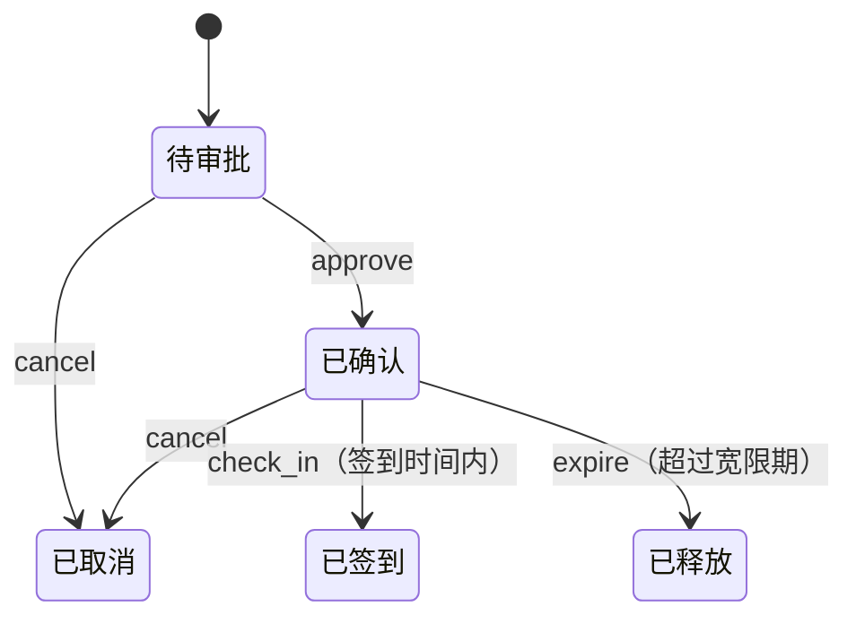

# 第 20 章　状态 State

> 本章要回答：一个对象在不同状态下，对同一个操作的反应完全不同时，怎样避免每个方法里都堆满“如果现在是某某状态”的判断？状态对象和一张转换表，各适合什么情况？

[第 01 章](../part-01/01-data-and-processing.md)讲过：有状态的对象，调用的结果不只取决于参数，还取决于它此刻处于什么状态。状态模式处理的，就是这种依赖变得复杂之后的情况。

## 眼前的任务

一家联合办公空间提供会议室预订。一个预订会经历这样的过程：

- 提交后是**待审批**；管理员审批后变成**已确认**；
- 已确认的预订，可以在开始前 10 分钟到开始后 15 分钟之间**签到**；
- 开始 15 分钟后还没签到，系统自动**释放**会议室；
- 审批前、签到前都可以**取消**。

## 不用模式的写法

用一个字符串记录状态，每个操作先检查当前状态：

```python
class Booking:
    def __init__(self, room: str, start: datetime) -> None:
        self.room, self.start = room, start
        self.status = "待审批"

    def approve(self) -> None:
        if self.status != "待审批":
            raise ValueError(f"{self.status}的预订不能审批")
        self.status = "已确认"

    def check_in(self, now: datetime) -> None:
        if self.status != "已确认":
            raise ValueError(f"{self.status}的预订不能签到")
        if not self.start - EARLY <= now <= self.start + GRACE:
            raise ValueError("不在签到时间内")
        self.status = "已签到"
```

状态只有两三个时，**这是好代码**。

## 变化：状态和操作越来越多

“取消”是后来加的。写它的同事想的是：已经取消的、已经释放的，不能再取消，其他都可以：

```python
    def cancel(self) -> None:
        if self.status in ("已取消", "已释放"):  # 后来加的，漏掉了“已签到”
            raise ValueError(f"{self.status}的预订不能取消")
        self.status = "已取消"
```

他漏掉了“已签到”。于是一场正在进行的会议，预订可以被取消，会议室在系统里变成了空闲，下一个人订了它，推门进来发现里面有人（测试 `test_cancel_after_check_in_slips_through`）。

## 困难在哪里

1. **一个状态的全部规则，散落在每个方法里。** 想知道“已签到的预订能做什么”，要把 `approve`、`check_in`、`expire`、`cancel` 四个方法全看一遍，从每个 `if` 里拼出答案。
2. **默认是“允许”。** `cancel` 用的是黑名单：列出不能取消的状态，其余都放行。每加一个新状态，就要回到每个用黑名单写法的方法里，判断要不要把它加进去。漏了，就是放行。
3. **状态的含义只在字符串里。** 拼错一个字（“已确定”），程序不会报错，只是所有判断都对不上。

## 状态模式：每个状态是一个对象

GoF 对状态模式的描述是：**允许一个对象在其内部状态改变时改变它的行为。对象看起来似乎修改了它的类。**

做法是：每个状态写成一个类，**只实现这个状态下允许的操作**。先定义一个基类，所有操作的默认行为都是**拒绝**：

```python
class State:
    name = "?"

    def approve(self, b: Booking) -> State:
        raise NotAllowed(f"{self.name}的预订不能审批")

    def cancel(self, b: Booking) -> State:
        raise NotAllowed(f"{self.name}的预订不能取消")

    def check_in(self, b: Booking, now: datetime) -> State:
        raise NotAllowed(f"{self.name}的预订不能签到")

    def expire(self, b: Booking, now: datetime) -> State:
        return self  # 只有“已确认”会因超时而改变，其他状态忽略
```

（超时检查是系统定时对所有预订执行的，所以对不相关的状态，它安静地什么也不做，而不是报错。）

每个具体状态只覆盖它允许的操作，并返回操作之后的新状态：

```python
class Confirmed(State):
    name = "已确认"

    def cancel(self, b: Booking) -> State:
        return Cancelled()

    def check_in(self, b: Booking, now: datetime) -> State:
        if not b.start - EARLY <= now <= b.start + GRACE:
            raise NotAllowed("不在签到时间内")
        return CheckedIn()

    def expire(self, b: Booking, now: datetime) -> State:
        return Released() if now > b.start + GRACE else self
```

已签到的状态什么都不允许，所以它的类里什么都不用写：

```python
class CheckedIn(State):
    name = "已签到"
```

预订对象本身不再判断状态，只是把操作转交给当前的状态对象，再换上它返回的新状态：

```python
    def cancel(self) -> None:
        self.state = self.state.cancel(self)

    def check_in(self, now: datetime) -> None:
        self.state = self.state.check_in(self, now)
```

现在，对已签到的预订调用 `cancel`，`CheckedIn` 没有覆盖 `cancel`，用的是基类的默认行为：拒绝（测试 `test_cancel_after_check_in_is_refused`）。

这个结构改变了两件事：

- **一个状态的全部规则在一个类里。** “已确认的预订能做什么”，读 `Confirmed` 就够了。
- **默认从“允许”变成了“拒绝”。** 以后加一个“暂停”状态，即使什么都不写，它也会拒绝所有操作，而不是悄悄放行（测试 `test_new_state_refuses_everything_by_default`）。忘了写，结果是用户看到一个“不允许”的提示，而不是会议室被错误释放。

下图是预订的完整状态转换。图上没有画出的箭头，就是不允许的操作：



### 角色对照

| GoF 角色 | 本例 | 职责 |
|---|---|---|
| 上下文（Context） | `Booking` | 持有当前状态，把请求转交给它 |
| 状态（State） | `State` 基类 | 定义所有操作的接口和默认行为 |
| 具体状态（ConcreteState） | `Pending`、`Confirmed`、`CheckedIn`、`Cancelled`、`Released` | 实现本状态下的行为，决定下一个状态 |

本例由状态对象**返回**下一个状态，上下文负责替换。GoF 也讨论过另一种做法：状态对象直接修改上下文的状态字段。返回新状态的写法让状态类不需要修改别的对象，更容易单独测试。

### 和策略的区别

状态模式和[第 17 章](17-strategy.md)的策略在结构上几乎一样：上下文持有一个可替换的对象，把工作交给它。区别在于**谁来替换**：

- 策略由**外部**选择和替换（顾客选了同城急送），策略之间互不知道对方。
- 状态由**状态自己**决定替换成谁（`Confirmed.check_in` 返回 `CheckedIn()`），状态之间知道彼此，共同组成一张转换图。

## 代价与边界

- **类多了。** 五个状态就是五个类，加一个基类。状态少、规则简单时，这比一个字符串加几个 `if` 重得多。
- **整体的转换图反而看不见了。** 每个类只知道从自己出发的转换。想看“从待审批到已释放有几条路”，要把五个类拼起来看。
- **状态对象之间互相引用。** `Confirmed` 要知道 `CheckedIn`、`Cancelled`、`Released` 的存在。新增或删除一个状态，可能要改好几个类。
- **状态之外的数据仍然在上下文里。** 签到时间窗口要用到预订的开始时间，所以状态方法要接收预订对象作为参数。如果状态需要的数据越来越多，状态和上下文之间的耦合也会越来越紧。

**什么时候不该用**：状态很少（两三个），每个状态下的行为差别不大，或者规则基本只是“哪些转换允许”。这时下一节的转换表更合适。

## Python 角度：枚举加一张转换表

回头看本例的规则，大部分其实只是“在哪个状态下，哪个操作能把它变成哪个状态”。这种规则，用一张表来写最直观：

```python
TRANSITIONS: dict[tuple[Status, str], Status] = {
    (Status.PENDING, "approve"): Status.CONFIRMED,
    (Status.PENDING, "cancel"): Status.CANCELLED,
    (Status.CONFIRMED, "cancel"): Status.CANCELLED,
    (Status.CONFIRMED, "check_in"): Status.CHECKED_IN,
    (Status.CONFIRMED, "expire"): Status.RELEASED,
}
```

`Status` 是一个 `Enum`，状态的名字拼错会直接报 `AttributeError`，不会像字符串那样悄悄对不上。表里没有的组合就是不允许，**默认同样是拒绝**。整个状态机的全貌集中在这五行里，还可以直接从表中列出每个状态允许的操作：

```python
def allowed(status: Status) -> list[str]:
    return [event for (s, event) in TRANSITIONS if s is status]
```

```text
待审批：approve, cancel
已确认：cancel, check_in, expire
已签到：（无可执行的操作）
```

这样的列表可以直接放进文档，或者让界面据此决定显示哪些按钮。

表的弱点在于**附加条件**。签到要检查时间窗口，超时要检查是否已过宽限期，这些不是“状态加操作”就能决定的。在表的写法里，它们只能写成 `fire` 方法里针对特定操作的 `if`：

```python
        if event == "check_in" and not (now and self.start - EARLY <= now <= self.start + GRACE):
            raise ValueError("不在签到时间内")
```

附加条件少的时候，这没有问题。如果每个状态下的行为都有不少自己的逻辑（不同状态下的提醒方式不同、计费规则不同、可编辑的字段不同），条件散落在 `fire` 里，又会回到本章开头的困难。那时，状态对象就更合适了，因为每个状态的全部行为可以写在自己的类里。

所以选择的依据是：

- **规则主要是“哪些转换允许”**：枚举加转换表。全貌一目了然，加一个转换就是加一行。
- **每个状态有大量不同的行为**：状态对象。每个状态的行为集中在一个类里。

两种写法有一个共同点值得保留：**没有明确允许的，就是不允许。**

## 小结

- 当对象在不同状态下对同一操作的反应完全不同，而且状态和操作越来越多时，状态模式把每个状态写成一个对象，只实现它允许的操作，由它决定下一个状态。
- 用一个默认全部拒绝的基类，可以把“忘了处理”从悄悄放行变成明确拒绝。
- 状态模式与策略结构相同，区别在于替换由状态自身决定，状态之间构成一张转换图。
- 在 Python 里，如果规则主要是允许哪些转换，用 `Enum` 加一张转换表更简单，状态机的全貌也更清楚；每个状态的行为差别很大时，再用状态对象。

## 练习

办公空间要加一个功能：已签到的会议可以**延长**30 分钟，但前提是会议室接下来的 30 分钟没有被别人预订；一场会议最多延长两次。

1. 用状态对象的写法，“延长”应该写在哪个类里？“最多两次”这个计数放在哪里？
2. 用转换表的写法，“延长”这个操作会把状态变成什么？表能不能表达“最多两次”？
3. 加上这个需求之后，你会选择哪种写法？

**思路提示**：延长只对已签到的会议有意义，所以写在 `CheckedIn` 里，而它不改变状态，返回 `self` 即可。“延长了几次”是预订本身的数据，不是状态，应该放在 `Booking` 上，由 `CheckedIn.extend` 读取和检查。“下一个时段没有被预订”需要查询其他预订，这又是一个附加条件。在转换表里，延长是 `(CHECKED_IN, "extend") → CHECKED_IN`，表能表达“允许延长”，但“最多两次”和“下一时段空闲”只能写进 `fire` 里的条件判断。附加条件增加到这个程度，状态对象的写法开始显出优势，因为与“已签到”有关的全部规则都集中在 `CheckedIn` 这一个类里。

完整代码：
- [`examples/ch20_booking_v1.py`](../../examples/ch20_booking_v1.py)：字符串状态与分散的判断（含错误）
- [`examples/ch20_state.py`](../../examples/ch20_state.py)：状态对象
- [`examples/ch20_pythonic.py`](../../examples/ch20_pythonic.py)：枚举与转换表

测试：[`tests/test_ch20_state.py`](../../tests/test_ch20_state.py)。
