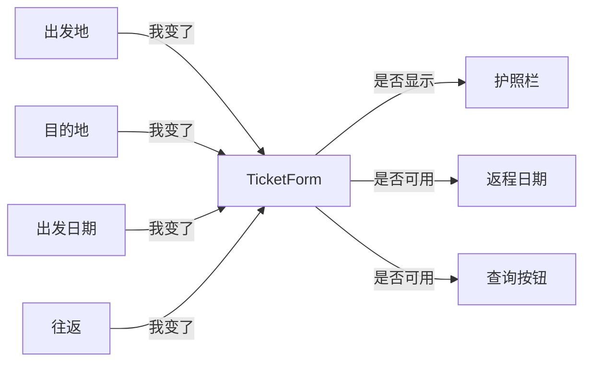

# 第 24 章　中介者 Mediator

> 本章要回答：一组对象彼此牵连，改一个就要影响好几个时，怎样避免它们互相引用、织成一张谁也理不清的网？

[第 18 章](18-observer.md)的观察者处理“一个对象变了，通知许多对象”。这一章的情况更纠缠：**许多对象之间互相影响**，每一个都可能是变化的起点，也可能是被影响的一方。

## 眼前的任务

一个机票预订页面上有这些控件：出发地、目的地、出发日期、“往返”复选框、返程日期、护照号码栏、查询按钮。它们之间有联动规则：

- 勾选“往返”时，返程日期才能填写；
- 出发地和目的地中，只要有一个在国外，就显示护照号码栏；
- 出发地、目的地、日期都填好，出发地和目的地不同，并且（如果是往返）填了返程日期，查询按钮才可用。

## 不用模式的写法

最直接的做法是：每个控件在自己的值改变时，去更新它影响到的那些控件。城市框持有查询按钮、护照栏和另一个城市框的引用：

```python
class CityBox(Widget):
    def __init__(self, search: SearchButton, passport: PassportField) -> None:
        super().__init__()
        self.search, self.passport = search, passport
        self.other: CityBox | None = None  # 另一个城市框，创建后再连上

    def set(self, city: str) -> None:
        self.value = city
        self.passport.visible = city not in DOMESTIC
        if self.other is not None and self.other.value is not None:
            self.search.enabled = city != self.other.value
```

“往返”复选框持有返程日期的引用，勾上时启用它。控件少的时候，每条规则都写在“触发它的那个控件”里，**看起来很自然**。

## 变化：规则越多，漏洞越多

问题出在护照栏的规则。“只要有一个城市在国外就显示”，这条规则涉及**两个**城市框，但每个城市框在更新护照栏时，只看了**自己**的值。

用户先选出发地“东京”，护照栏出现了；再选目的地“上海”，上海是国内城市，目的地框把护照栏藏了起来。东京飞上海是国际航线，护照栏却不见了（测试 `test_passport_depends_on_whichever_city_changed_last`）。

查询按钮的规则更复杂：它取决于五个控件。按这种写法，五个控件都要持有查询按钮的引用，都要在自己改变时判断一遍完整的条件，而每个控件只知道自己和少数几个邻居的状态。

## 困难在哪里

1. **规则涉及多个控件，却被写在了其中某一个控件里。** 一条规则被拆成了好几段，分布在每一个可能触发它的控件中，每一段都只看到局部。
2. **引用织成了网。** n 个控件两两牵连，最多有 n×(n-1) 条引用。加一个“乘客类型”下拉框，要找出它和其他每个控件的关系，再到相应的类里各加一段代码。
3. **控件无法复用。** `CityBox` 认识查询按钮和护照栏，它只能用在这个表单里。

## 中介者：控件只和表单说话

GoF 对中介者的描述是：**用一个中介对象来封装一系列的对象交互。中介者使各对象不需要显式地相互引用，从而使其耦合松散，而且可以独立地改变它们之间的交互。**

做法是：控件不再认识彼此，只认识一个**中介者**。值改变时，控件只告诉中介者“我变了”：

```python
class Field:
    def __init__(self, mediator: Mediator, value: object = None, visible: bool = True) -> None:
        self.mediator = mediator
        self.value = value
        self.enabled = True
        self.visible = visible

    def set(self, value: object) -> None:
        self.value = value
        self.mediator.changed(self)  # 控件不认识别的控件，只告诉中介者
```

所有联动规则集中在中介者，也就是表单里。表单认识所有控件；任何控件变了，它都**从完整的表单内容重新算出**所有联动状态：

```python
    def _refresh(self) -> None:
        """每次有控件变化，都从完整的表单内容重新算出所有联动状态。"""
        cities = {self.origin.value, self.dest.value} - {None}
        self.passport.visible = any(c not in DOMESTIC for c in cities)
        self.return_date.enabled = bool(self.round_trip.value)
        self.search.enabled = (
            self.origin.value is not None
            and self.dest.value is not None
            and self.origin.value != self.dest.value
            and self.depart.value is not None
            and (not self.round_trip.value or self.return_date.value is not None)
        )
```

护照栏的规则现在同时看两个城市，东京飞上海时显示护照栏，改成北京飞上海时又隐藏了（测试 `test_passport_considers_both_cities`）。查询按钮的完整条件写在一处，测试 `test_search_needs_a_complete_and_sensible_form` 逐步检查了它在各种情况下的状态。

`Field` 只有四个属性：中介者、值、是否可用、是否可见，不引用任何别的控件（测试 `test_fields_do_not_know_each_other`）。它可以用在任何表单里。

下图是中介者之后的结构：控件之间不再有箭头，所有联系都经过表单。



### “全部重算”的取舍

本例的中介者不管哪个控件变了，都把所有规则重算一遍。这是一个有意的选择：

- **好处**：不可能漏掉某条路径。规则只描述“在什么情况下应该是什么样子”，不描述“谁变了要更新谁”，所以不存在“某个控件改变时忘了更新某个状态”的问题。本章开头的护照栏错误，正是“按变化路径更新”的产物。
- **代价**：每次都重算全部规则。对一个只有十几个控件的表单，这点计算无足轻重；如果某条规则很昂贵（比如要查询服务器上的余票），就要按 `changed(field)` 的参数区分是谁变了，只重算受影响的部分。

### 角色对照

| GoF 角色 | 本例 | 职责 |
|---|---|---|
| 中介者（Mediator） | `Mediator` 协议 | 定义同事对象通知它的接口 |
| 具体中介者（ConcreteMediator） | `TicketForm` | 认识所有同事，实现它们之间的协作规则 |
| 同事（Colleague） | `Field` | 只认识中介者，变化时通知它 |

### 和观察者的区别

两者都在“对象变了，其他对象要反应”的场景里出现，但关注点不同：

- **观察者**：目标不关心谁在听，也不关心它们做什么。订阅者之间互不相干，规则分散在各个订阅者里。
- **中介者**：中介者**知道**所有参与者，**集中**了它们之间的协作规则。

实际上，同事对象通知中介者这一步，本身就可以用观察者实现：中介者订阅每个控件的“值改变”事件。两者经常一起出现。

## 代价与边界

- **中介者可能变成一个什么都管的大类。** 所有规则都集中到了这里。表单有五十个控件、上百条规则时，`_refresh` 会变得很长。这时可以把规则按主题拆成几个函数，或者把表单拆成几个各有中介者的小区域。
- **复杂度是搬过来的，不是消失的。** 控件之间的关系依然存在，只是从“分散在每个控件里”变成了“集中在一处”。集中通常更容易理解，但读中介者的人仍然要理解全部的规则。
- **中介者本身难以复用。** 控件变得可以复用，代价是中介者变得非常具体：`TicketForm` 只能用于订票。

**什么时候不该用**：对象之间的关系简单，比如只有“勾选往返，启用返程日期”这样一对一的联动。直接让复选框更新日期栏就好，引入中介者反而让一个简单的关系变得间接。

## Python 角度：联动状态是一个纯函数

`_refresh` 有一个值得注意的特点：它算出的联动状态，**完全由表单的内容决定**。同样的内容，算出来的状态永远一样。既然如此，它可以写成一个纯函数：输入一份表单内容，输出界面应该怎样显示：

```python
def ui_state(v: FormValues) -> UiState:
    cities = {v.origin, v.dest} - {None}
    return UiState(
        passport_visible=any(c not in DOMESTIC for c in cities),
        return_date_enabled=v.round_trip,
        search_enabled=(
            v.origin is not None
            and v.dest is not None
            and v.origin != v.dest
            and v.depart is not None
            and (not v.round_trip or v.return_date is not None)
        ),
    )
```

`FormValues` 和 `UiState` 都是冻结的数据类。这个函数和 `TicketForm` 遵守完全相同的规则（测试 `test_same_rules_as_the_mediator` 对几种表单内容逐一比较），但它有几个额外的好处：

- **测试极其简单**：构造一份 `FormValues`，检查返回的 `UiState`。不需要创建控件，不需要模拟用户的操作顺序。
- **规则和界面完全分开**：同一个函数可以用于网页、手机应用，甚至用于服务器端检查提交的数据是否合理。
- **没有“更新顺序”的问题**：没有什么被修改，所以也不存在先改谁后改谁。

这正是[第 01 章](../part-01/01-data-and-processing.md)里“数据与处理分开”的又一次应用。很多现代界面框架也采用了类似的思路：界面是状态的函数，状态变了，就重新计算界面应该是什么样子。

那么中介者对象还有用吗？有。总得有一个地方，在用户改动控件时收集最新的表单内容、调用 `ui_state`、再把结果应用到真实的控件上。这个“地方”就是中介者，只不过它变得很薄：联动规则本身交给了纯函数，中介者只负责“收集、计算、应用”。

## 小结

- 当一组对象互相影响、每一个都可能是变化的起点时，中介者让它们只和一个中心对象通信，由它集中管理所有协作规则。
- 中介者把复杂度集中起来，而不是消除它。中心对象可能变大，需要按主题拆分。
- “任何变化都从完整状态重算全部规则”的写法，可以避免按变化路径更新时漏掉某条路径。
- 在 Python 里，如果联动状态只取决于当前的内容，把规则写成纯函数，中介者只负责收集输入和应用结果。规则更容易测试，也可以在不同界面之间复用。

## 练习

订票页面加了一个“乘客类型”下拉框：成人、儿童、婴儿。新规则：

- 婴儿不能单独乘机：选了“婴儿”时，查询按钮显示“请先添加一名成人”并且不可用；
- 国际航线上，所有乘客都需要护照（不论成人、儿童还是婴儿）。

1. 在本章开头的写法里，加这两条规则需要修改哪些类？
2. 在中介者的写法里，需要修改哪里？
3. 在纯函数的写法里，`FormValues`、`UiState`、`ui_state` 各要怎样变化？怎样测试“婴儿 + 国际航线”的组合？

**思路提示**：开头的写法里，乘客类型要影响查询按钮，于是新的下拉框要持有查询按钮的引用，并且要在自己改变时判断一遍完整的查询条件，还要和城市框的判断保持一致，很容易出错。中介者的写法只需要在 `TicketForm` 里加一个控件，并在 `_refresh` 的查询条件里加一项。纯函数的写法里，`FormValues` 加一个 `passenger` 字段，`UiState` 可能加一个 `search_hint` 字段来放提示文字，`ui_state` 里加相应的规则；测试只需要构造 `FormValues(origin="东京", dest="上海", passenger="婴儿", ...)`，检查结果即可。第二条规则（“所有乘客都需要护照”）其实不改变任何联动，护照栏本来就按城市显示。读需求时分辨出“哪些规则其实已经满足了”，和写新规则一样重要。

完整代码：
- [`examples/ch24_form_v1.py`](../../examples/ch24_form_v1.py)：控件互相引用（含错误）
- [`examples/ch24_mediator.py`](../../examples/ch24_mediator.py)：`TicketForm` 中介者
- [`examples/ch24_pythonic.py`](../../examples/ch24_pythonic.py)：联动状态的纯函数

测试：[`tests/test_ch24_mediator.py`](../../tests/test_ch24_mediator.py)。
