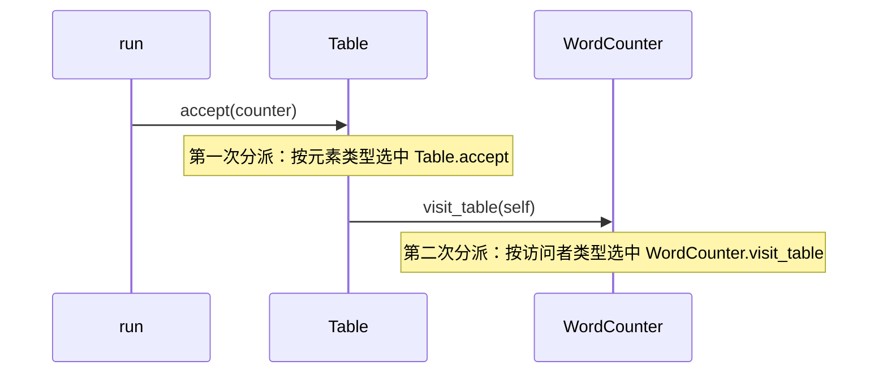

# 第 26 章　访问者 Visitor

> 本章要回答：一组对象的种类基本固定，但要对它们做的操作越来越多时，新操作应该写在哪里？在 Python 里，`match` 和 `singledispatch` 能不能替代访问者？

前面很多模式都在处理“新增一种东西”：新增一种配送方式、一种比赛、一个状态。访问者处理的是反方向的问题：**东西的种类很少变，要对它们做的事情却越来越多。**

## 眼前的任务

一个内容平台的文章由几种内容块组成：标题、段落、图片、表格。

```python
article = [
    Heading(1, "春季露营指南"),
    Paragraph("带上防潮垫和保暖衣物。"),
    Image("tent.jpg"),
    Table([["物品", "数量"], ["帐篷", "1"]]),
]
```

平台要对文章做各种处理：统计字数、导出纯文本、检查无障碍问题（图片有没有替代文字）、生成目录……每隔一段时间就会多一种。

## 不用模式的写法

最符合面向对象直觉的做法，是把每种操作写成内容块上的方法。基类给出默认值，各个子类覆盖：

```python
class Block:
    def word_count(self) -> int:
        return 0  # 默认值：子类没写就算 0

    def to_text(self) -> str:
        return ""
```

标题和段落的 `word_count` 返回文字的字数，图片返回 0（替代文字不算正文）。

## 变化：新块漏了一个方法

表格是后来加的。写表格的同事实现了 `to_text`，忘了 `word_count`。基类的默认值是 0，所以程序没有报错，表格里的字就这样悄悄地没被统计进去：文章应该有 24 个字，统计结果是 17（测试 `test_forgotten_method_silently_counts_zero`）。

接下来还要加“无障碍检查”“生成目录”“估算阅读时间”……每加一种操作，就要打开四个类，各加一个方法。负责无障碍检查的人，要去修改标题、段落、表格这些和无障碍关系不大的类。

## 困难在哪里

1. **一种操作的代码，被拆散到了每个类里。** “怎样统计字数”分布在四个文件中。想看完整的字数规则，要把四个类都看一遍。
2. **加操作要改所有类。** 内容块的类成了一个公共的“堆放处”，每个功能都往里面加方法，类越来越大，和每个功能都有关系。
3. **漏写不报错。** 基类的默认值让漏掉的实现悄无声息。

如果把这个问题倒过来看：**内容块的种类很少变化**（标题、段落、图片、表格，几年都不会变），**操作的种类经常变化**。那么，能不能把“一种操作”的全部代码放在一起，而不是分散到每个内容块里？

## 访问者：把操作从对象中拿出来

GoF 对访问者的描述是：**表示一个作用于某对象结构中的各元素的操作。它使你可以在不改变各元素的类的前提下定义作用于这些元素的新操作。**

一种操作就是一个“访问者”类，它为**每一种**内容块各准备一个方法。访问者的基类把这些方法都声明为抽象的：

```python
class Visitor(ABC):
    @abstractmethod
    def visit_heading(self, b: Heading) -> None: ...

    @abstractmethod
    def visit_paragraph(self, b: Paragraph) -> None: ...

    @abstractmethod
    def visit_image(self, b: Image) -> None: ...

    @abstractmethod
    def visit_table(self, b: Table) -> None: ...
```

每个内容块只需要一个方法 `accept`，它告诉访问者“我是哪一种”：

```python
@dataclass
class Table:
    rows: list[list[str]]

    def accept(self, v: Visitor) -> None:
        v.visit_table(self)
```

现在，“统计字数”的全部规则都在一个类里：

```python
class WordCounter(Visitor):
    def __init__(self) -> None:
        self.total = 0

    def visit_heading(self, b: Heading) -> None:
        self.total += chars(b.text)

    def visit_paragraph(self, b: Paragraph) -> None:
        self.total += chars(b.text)

    def visit_image(self, b: Image) -> None:
        pass  # 图片的替代文字不算正文字数

    def visit_table(self, b: Table) -> None:
        self.total += sum(chars(cell) for row in b.rows for cell in row)
```

依次让每个内容块接受访问：

```python
def run(blocks: list[Block], visitor: Visitor) -> Visitor:
    for b in blocks:
        b.accept(visitor)
    return visitor
```

字数是 24，表格里的字也算进去了（测试 `test_word_count`）。

无障碍检查是另一个访问者，负责它的人只写一个新类，不碰任何内容块：

```python
    def visit_image(self, b: Image) -> None:
        if not b.alt.strip():
            self.problems.append(f"图片 {b.src} 缺少替代文字")
```

**漏写不再沉默。** 因为 `Visitor` 的四个方法都是抽象的，一个只实现了 `visit_heading` 的访问者，连对象都创建不出来（测试 `test_visitor_must_handle_every_block`）。即使某种内容块对这个操作确实没有意义（比如字数统计里的图片），也必须**明确地**写一个 `pass`，并在注释里说明理由。

### 双重分派

`b.accept(visitor)` 这一步有一个专门的名字：**双重分派**。最终执行哪段代码，取决于**两个**对象的类型：内容块是哪一种（决定调用 `visit_table` 还是 `visit_image`），访问者是哪一种（决定是统计字数还是检查无障碍）。Java、C++ 这类语言的方法调用只根据一个对象的类型来选择，所以需要 `accept` 这个“中转”来实现两次选择。下文会看到，Python 有更直接的办法。

以表格为例，双重分派的两步如下：



### 角色对照

| GoF 角色 | 本例 | 职责 |
|---|---|---|
| 访问者（Visitor） | `Visitor` | 为每种元素声明一个访问方法 |
| 具体访问者（ConcreteVisitor） | `WordCounter`、`AltChecker` | 实现一种操作，可以在访问过程中积累结果 |
| 元素（Element） | 有 `accept` 方法的内容块 | 接受访问者，调用对应的访问方法 |
| 对象结构（ObjectStructure） | 文章（内容块列表）、`run` | 让访问者逐个访问其中的元素 |

## 代价与边界

访问者的取舍非常鲜明，GoF 原书也明确指出了这一点：

- **加一种操作很容易**：写一个新的访问者类，不用改任何内容块。
- **加一种内容块很困难**：要在 `Visitor` 上加一个 `visit_video`，然后修改**每一个**已有的访问者。

所以，访问者只适合**元素种类稳定、操作种类多变**的情况。如果内容块的种类也经常变化，访问者会让每次变化都波及所有操作。

其他代价：

- **元素的内部要对访问者公开。** `WordCounter` 要读 `b.text`、`b.rows`，内容块不能把这些藏起来。
- **`accept` 是纯粹的样板代码。** 每个内容块都要写一个几乎一样的方法，它存在的唯一理由是绕过语言的单分派限制。
- **结构的遍历方式是另一个问题。** 本例的文章是一个平铺的列表。如果内容块可以嵌套（引用块里有段落和图片），谁来负责往下走：访问者，还是元素自己的 `accept`？两种做法都可以，但必须选定一种。

**什么时候不该用**：内容块的种类还在频繁变化，或者操作只有一两种。把方法直接写在类上（并且去掉那个危险的默认值，改成抽象方法），是更直接的选择。

## Python 角度：`match` 与 `singledispatch`

Python 不需要 `accept` 来做双重分派，它有两种直接按类型选择代码的工具。

### `match` 语句

Python 3.10 引入的 `match` 可以按对象的类型匹配，还能顺手取出字段。一种操作写成一个函数，所有种类的处理集中在一起：

```python
def to_text(b: Block) -> str:
    match b:
        case Heading(level, text):
            return "#" * level + " " + text
        case Paragraph(text):
            return text
        case Image(src, alt):
            return f"[图片：{alt or src}]"
        case Table(rows):
            return "\n".join(" | ".join(row) for row in rows)
        case _:
            assert_never(b)
```

最后一个分支的 `assert_never`（Python 3.11 加入 `typing`）有两层作用。运行时，遇到不认识的类型会抛出 `AssertionError`，而不是悄悄返回 `None`（测试 `test_unknown_block_type_is_an_error`）。更重要的是，`Block` 被声明为 `Heading | Paragraph | Image | Table`，如果以后给 `Block` 加了 `Video`，却忘了在这里加 `case`，mypy、pyright 这类类型检查器会在**运行之前**报告这个遗漏。这相当于访问者基类里“抽象方法必须全部实现”的检查，只是由类型检查器来完成。

### `functools.singledispatch`

另一种做法是 `functools.singledispatch`：先定义一个通用函数，再为每种类型注册一个实现：

```python
@singledispatch
def word_count(b: object) -> int:
    raise TypeError(f"不知道怎样统计 {type(b).__name__} 的字数")


@word_count.register
def _(b: Heading) -> int:
    return chars(b.text)
```

它根据第一个参数的类型选择实现。和 `match` 相比，`singledispatch` 的实现可以分散在不同的模块里注册，别的模块可以为自己定义的新类型补充实现；代价是没有类型检查器的穷尽检查，漏掉的类型只会在运行时走到默认实现，所以默认实现应该抛出异常，而不是返回一个看起来合理的值。

三种写法的选择：

- **元素种类固定、类型都在你手里**：`match` 加 `assert_never`。代码最直接，遗漏可以被类型检查器发现。
- **别的模块需要为新的类型补充实现**：`singledispatch`。
- **在写一个供别人扩展的框架，使用者习惯面向对象的接口**，或者访问者在遍历中需要积累复杂的状态：经典的访问者类。

## 小结

- 当元素的种类稳定、操作的种类经常增加时，访问者把每种操作集中到一个类里，为每种元素各写一个方法；新增操作不需要修改元素。
- 代价是新增元素种类很困难：所有访问者都要修改。这一取舍决定了访问者只适合元素稳定的场合。
- 访问者基类用抽象方法强制处理每一种元素，把“漏写”从沉默的错误变成立即的报错。不要在基类里给出“看起来合理”的默认值。
- 在 Python 里，`match` 加 `assert_never` 或 `functools.singledispatch` 可以直接按类型分派，通常不需要 `accept` 这样的双重分派样板。

## 练习

平台要支持在文章里插入视频，视频有地址、时长和字幕文本。

1. 在访问者的写法里，加入视频需要修改哪些地方？如果有十个访问者，工作量有多大？
2. 视频的字幕要不要算进字数？无障碍检查应该检查视频的什么？这些决定由谁来做？
3. 如果平台计划在接下来半年里陆续加入音频、投票、地图等新的内容块，你还会选择访问者吗？

**思路提示**：要在 `Visitor` 上加 `visit_video`，给视频加 `accept`，然后修改每一个访问者。十个访问者就是十处修改，但它们都会因为缺少抽象方法而无法实例化，所以不会漏掉，这是访问者的代价，也是它的保障。第 2 问说明了这种“强迫”的价值：每个访问者的负责人都必须针对视频做出明确的决定（字幕算不算字数；无障碍检查要求视频必须有字幕），而不是被一个默认值悄悄带过。第 3 问：如果内容块的种类在快速增长，访问者的代价会反复出现。这时把方法放回内容块上（用抽象方法强制实现），或者用 `match` 让类型检查器帮你找遗漏，可能更合适。选择访问者之前，先判断哪个维度更稳定。

完整代码：
- [`examples/ch26_article_v1.py`](../../examples/ch26_article_v1.py)：方法写在内容块上，带默认值（含错误）
- [`examples/ch26_visitor.py`](../../examples/ch26_visitor.py)：访问者、字数统计与无障碍检查
- [`examples/ch26_pythonic.py`](../../examples/ch26_pythonic.py)：`match`、`assert_never` 与 `singledispatch`

测试：[`tests/test_ch26_visitor.py`](../../tests/test_ch26_visitor.py)。
